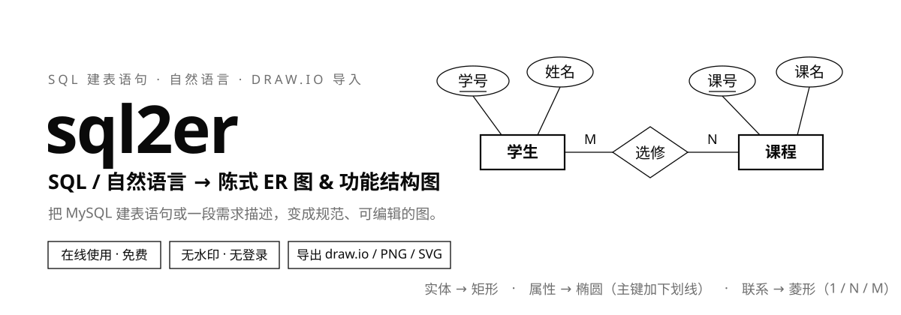

<div align="center">
  
</div>

<div align="center">

[](https://ai-diagram-generator-csp.vercel.app/)
[](https://vuejs.org/)
[](https://www.typescriptlang.org/)
[](https://vite.dev/)
[](#开发命令)

**👉 [ai-diagram-generator-csp.vercel.app](https://ai-diagram-generator-csp.vercel.app/)**

</div>

## 郑重声明

- 本项目**完全非商业**，不接广告、不收费、无付费墙，仅供广大学习者学习与技术交流使用。
- 项目的初衷是满足自身个性化需求（只需要 **ER 图生成** 与 **功能结构图生成** 两个功能），并在动手实践中学习相关技术，不存在商业发展的目的。
- AI 生成功能所需的模型服务、接口地址与 API Key **需自行提供**；本项目不内置、不代理、也不存储任何密钥。
- 本项目在开发过程中，借助逆向工具对下列网站的交互与布局做了学习性参考，在此郑重致谢；相关网站的著作权归原作者所有：
  - <https://ai.mtycode.com/>
  - <https://sql.cengxuyuan.cn/>
  - <https://huahub.com.cn/tools/sql-er>
- 若原作者认为本项目的内容构成侵权，请提交 Issue 或通过其他方式联系我，我会第一时间核实并处理。

## 这是什么

sql2er 把两类输入变成两种图，全程浏览器出图、随时导出：

- **SQL / 自然语言 → 陈式（Chen）ER 图**
  - **实体** → 矩形
  - **属性** → 椭圆（主键加下划线）
  - **联系** → 菱形（两端标注基数 `1 / N / M`）
- **系统描述 / 缩进大纲 / Markdown 标题 → 功能结构图（模块图）**
  - 第 1–2 层（系统 / 模块）横排文字，第 3 层起（功能 / 子功能）逐字竖排
  - 黑白线稿：白底、黑色 1.5px 直角矩形、无箭头直角折线

无水印、无付费墙、无登录。顶部可在「ER 图 / 功能结构图」之间切换。

> SQL 解析、结构树编辑和大纲解析**不需要任何配置**；自然语言生成与 AI 补全需要模型 —— 线上使用时点右上角「模型设置」直接填写即可，本地部署见[快速开始](#快速开始)。

## 功能

| 输入 | 说明 |
| --- | --- |
| SQL 建表 | 后端用 `@guanmingchiu/sqlparser-ts`（datafusion-sqlparser-rs 的 WASM 绑定）解析 MySQL AST，提取表名、中文 `COMMENT`、主键、`FOREIGN KEY`（含 `ALTER TABLE ... ADD CONSTRAINT` 形式）。外键列不再重复画成属性；「恰好两个外键、指向两张不同的表、且没有被别的表引用」的关联表会直接画成多对多联系菱形，其余列挂成菱形上的属性 |
| 自然语言 | 后端调用 OpenAI 兼容的 Chat Completions：**核心生成**先产出实体与主要联系；**全量生成**使用独立提示词，一次请求直接产出更完整的实体、属性与联系 |
| 导入 .drawio | 解析 draw.io 文件（未压缩 XML 与默认的 base64+deflate 压缩格式均可），按形状还原实体/属性/联系、`<u>` 主键与原始排版 |
| AI 补全 | 基于当前图里的实体与属性，推断缺失联系，并补充业务描述中提到、但图中没有的属性；同名属性自动跳过，已有主键的实体不会新增第二个主键 |

| 输出 | 说明 |
| --- | --- |
| draw.io | `.drawio` 可编辑文件，矩形/椭圆/菱形 + 边基数标签，主键用 HTML 下划线 |
| PNG | 2 倍分辨率位图 |
| SVG | 矢量图 |

布局默认 **智能布局**：实体作为 hub，联系菱形落在两实体的轴线上，属性按联系方向分槽、由内向外扫描半径并避让节点与连线，十几个到二十几个属性会贴着矩形形成紧凑的多层环，再做物理迭代与交叉最小化。另有 **环形网格**、**力导向**（d3-force）、**分层**（elkjs layered）可切换。从 draw.io 导入后额外提供「导入原位置」，保留文件里的坐标。

画布操作：滚轮缩放、右键拖拽平移、左键拖拽节点或框选、Shift 多选、双击改名、Ctrl+Z 撤销；拖动实体/联系会带着其属性一起移动，框选多个节点后可整组拖动。

## 功能结构图（v2.0）

| 输入 | 说明 |
| --- | --- |
| 结构树编辑 | 左侧树形列表增删改、拖拽调整层级与同级顺序、一键清空 / 恢复示例 / 换一换（内置 3 个示例） |
| 大纲文本 | 空格或 Tab 缩进层级，或 Markdown 标题 `# 系统 / ## 模块 / ### 功能`；行首 `-`、`*`、`•` 会被忽略 |
| AI 生成 | 输入系统描述，调用 OpenAI 兼容模型生成「系统 → 模块 → 功能」树，层级深度由描述决定（最多 6 层、200 个节点） |

布局与交互：

- 叶子节点从左到右等距排布，父节点居中于首尾子节点；同层做最多 8 轮重叠修正
- 同层统一尺寸：系统默认最小 120×40、模块 100×36、竖排功能 32×32，再按本层最长文案自适应
- 连接线：父框底边中点 → 水平折线 → 子框顶边中点，无箭头
- 画布：滚轮缩放、右键平移、拖拽矩形并显示虚线吸附、双击改名、Ctrl+Z 撤销、全屏编辑
- 导出：PNG、SVG、draw.io（竖排文字按每字一行保留，连线带折线路径点）

## 快速开始

```bash
npm install
cp .env.example .env      # 填入 LLM_BASE_URL / LLM_API_KEY / LLM_MODEL
npm run dev               # 同时启动后端(3001) 与前端(5173)
```

打开 <http://127.0.0.1:5173> 。

> SQL 模式、结构树编辑和大纲解析不依赖大模型，`.env` 不填也能用；自然语言生成、AI 补全和 AI 生成功能结构图需要配置模型。也可以点右上角「模型设置」，直接在界面填写接口地址、API Key 和模型名称；界面配置通过请求头覆盖 `.env`，留空字段继续沿用 `.env`，且只保存在当前浏览器。

### 环境变量

| 变量 | 必填 | 说明 |
| --- | --- | --- |
| `LLM_BASE_URL` | 否 | OpenAI 兼容端点，如 `https://api.deepseek.com/v1` |
| `LLM_API_KEY` | 否 | 对应服务的 API Key |
| `LLM_MODEL` | 否 | 模型名，如 `deepseek-chat` |
| `ACCESS_CODE` | 否 | 设置后所有接口需带 `x-access-code`；前端「访问码」按钮可保存到本地 |
| `RATE_LIMIT_PER_MIN` | 否 | 单 IP 每分钟请求上限，默认 20；填 0 关闭 |
| `PORT` | 否 | 后端端口，默认 3001 |

## API

所有接口统一信封：`{ code, msg?, data, warnings? }`，`code === 0` 表示成功。

```
POST /api/parseSQL                    { sql: string } | { sqls: string[] }
  → data: { tables: ParsedTable[] }

POST /api/ai/generate-er              { prompt: string, mode?: "core" | "full" }
  → data: { entities: [{ name, attributes: [{ name, primaryKey }] }],
            relationships: [{ source, target, type, text, attributes }] }

POST /api/ai/complete-er              { entities: [{ name, attributes }], hint?: string }
  → data: { relationships: [{ source, target, type, text, attributes }],
            attributes: [{ entity, attributes: [{ name, primaryKey }] }] }

POST /api/ai/generate-module-tree     { prompt: string }
  → data: { tree: { name, children: [{ name, children: [...] }] } }

POST /api/ai/generate-relationships    { entities: [{ name, attributes }], hint?: string }
  → data: [{ source, target, type, text, attributes }]   // 旧接口，仅返回联系

GET  /api/health
```

`type` 取值：`oneToOne` | `oneToMany`（source 是 1 端）| `manyToMany`。
`mode` 缺省为 `core`；`full` 使用独立的「全量生成」系统提示词，只请求一次，直接产出更完整的实体、属性与联系，不复用核心生成或补全链路。

AI 接口还可以带 `x-llm-base-url`、`x-llm-api-key`、`x-llm-model` 请求头，用于覆盖服务端模型配置（界面「模型设置」就是这些请求头的封装）。

```bash
curl -X POST https://ai-diagram-generator-csp.vercel.app/api/parseSQL \
  -H 'Content-Type: application/json' \
  -d '{"sql":"CREATE TABLE t (id int PRIMARY KEY COMMENT \"编号\") COMMENT=\"表\";"}'
```

## 部署到 Vercel

仓库已带 `vercel.json`：前端静态托管 + 单个 serverless 函数复用同一个 Express 应用。入口源文件是 `server/vercel.ts`，由 esbuild 打包为自包含的 `api/index.js`（构建产物，**已提交入库**），所有 `/api/*` 请求经 `rewrites` 转发到它。

```bash
npm i -g vercel
vercel link              # 首次：创建/关联 Vercel 项目
npm run build:api        # 改动 server/ 后重新生成 api/index.js
git commit && git push   # push 自动触发部署（已配置 GitHub 集成）
```

在 Vercel 项目的 Settings → Environment Variables 里配置 `LLM_BASE_URL`、`LLM_API_KEY`、`LLM_MODEL`（可选 `ACCESS_CODE`、`RATE_LIMIT_PER_MIN`）即可。

注意事项：

- **改动 `server/` 下任何代码后，必须先 `npm run build:api` 更新 `api/index.js` 并一并提交**，否则线上函数不会变化。
- 不要把函数改回 `api/[...all].ts` 形式：`@vercel/node` 不会打包 `api/` 目录之外的相对导入（线上 `ERR_MODULE_NOT_FOUND`）；catch-all 文件名也只匹配单段路径（`/api/ai/generate-er` 会在 Vercel 层 404）。当前的「esbuild 自包含打包 + rewrites」方案已绕开这两个坑。
- `vercel.json` 中函数 `maxDuration` 为 60s（LLM 生成通常 5–30s；Hobby 计划上限 60s）。
- 限流基于内存，多实例间不共享，属轻量防护。
- SQL 解析首次调用需加载 WASM，冷启动约几百毫秒。

## 目录结构

```
sql2er/
├── api/index.js           # Vercel serverless 函数（build:api 产物，需提交入库）
├── server/                # Express + TypeScript
│   ├── vercel.ts          # serverless 入口源文件（esbuild 打包为 api/index.js）
│   ├── app.ts             # 应用装配（本地与 serverless 共用）
│   ├── routes/            # /api/parseSQL、/api/ai/*
│   ├── services/          # sql-parser / ai-client / ai / prompts / rate-limit
│   └── middleware/guard.ts
├── shared/er-model.ts     # 前后端共享：ER 图模型 + SQL/AI → 陈式图转换
├── shared/module-tree.ts  # 前后端共享：功能结构树 + 大纲解析 + 树操作 + AI 结果规整
├── client/                # Vue 3 + Vite + Pinia + Element Plus
│   ├── components/        # ErCanvas / ModuleCanvas / InputPanel / ModulePanel / Toolbar
│   ├── core/              # theme / geometry / layout / smart-layout / module-layout / export / import
│   ├── stores/            # diagram.ts / module.ts
│   └── http/api.ts
├── assets/readme/         # README 视觉素材（hero.svg）
├── tests/                 # vitest：解析、转换、布局、draw.io 导入导出、功能树
├── vercel.json
└── vite.config.ts
```

## 开发命令

```bash
npm run dev          # 前后端并行
npm run dev:server   # 仅后端
npm run dev:client   # 仅前端
npm test             # 单元测试
npm run typecheck    # 前端 vue-tsc + 后端 tsc
npm run build        # 构建前端到 dist/
npm run build:api    # 打包 serverless 入口到 api/index.js（改动 server/ 后执行）
```

## 设计说明

- **图模型**统一为 `{ nodes, links }`，SQL 与 AI 两条输入路径都先转换成它再渲染，扩展新输入方式只需产出同样的结构。
- **外键语义**：持外键的一方是「多」端，因此外键被画成 `持有表 --N--> 菱形 --1--> 被引用表`。
- **菱形位置**：网格布局下，联系菱形自动落在两端实体连线的中点；同一对实体的多条联系会垂直错开。
- **功能结构图布局**：第 0/1 层横排、第 2 层起竖排；同层宽高按本层最长文案对齐；叶子等距排布后把父节点居中，再迭代修正同层重叠；连线固定为「父框底边 → 水平段 → 子框顶边」。
- **功能树编辑**：所有增删改与拖拽都会先深拷贝当前树，再写入撤销历史；拖动矩形只保存相对自动布局的偏移，可随时「重新排版」恢复。
- **ELK 按需加载**，默认的环形网格布局不会下载它。
